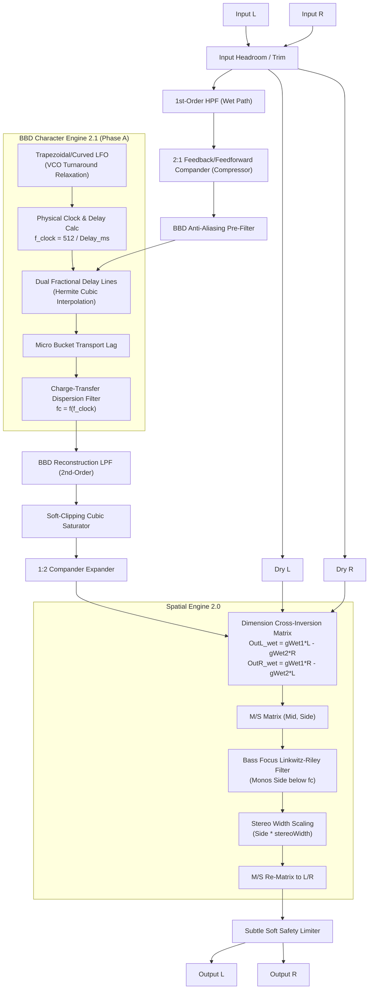

# Dimension5 — DSP & System Architecture

## 1. Overview & Sonic Philosophy

**Dimension5** is an authentic, embedded-ready, real-time stereo chorus simulator of the iconic Roland/Boss Dimension chorus (Dimension D SDD-320 / DC-2). It targets **STM32H562 (ARM Cortex-M33)**, **JUCE 8 (VST3/AU/Standalone)**, and **WebAssembly (WebAudio)** with a shared, bit-exact C99 core.

The Dimension sound is defined by:
- Subtle, non-vibrato chorus modulation.
- Wide stereo image with a fully solid, anchored center.
- Pure anti-phase modulated delay lines ($LFO_L = -LFO_R$).
- Cross-inverted Dimension summing matrix.
- Analog compander (inspired by NE570/NE571).
- **Spatial Engine 2.0**: Mid/Side reconstruction, True Stereo Width ($0–200\%$), and Mono Bass Focus ($0–400\text{ Hz}$).
- **BBD Character Engine 2.1 (Phase A)**: Physical clock modeling, soft VCO turnaround curvature, bucket transport lag, and clock-tracking baseband dispersion without artificial noise or digital aliasing.

---

## 2. Complete Audio Signal Flow

---

## 3. Physical BBD Reference Model

Bucket Brigade Devices (e.g., Panasonic/Matsushita **MN3007** or **MN3207**) transfer packets of charge across an array of MOS capacitors driven by a complementary two-phase clock ($\Phi_1, \Phi_2$).

### 3.1 Stage Count and Clock Conventions
- **Stages ($N$)**: The classic Dimension chorus utilizes $1024$-stage BBD chips (such as the MN3007).
- **Clock Phases**: Charge is handed off once per full clock cycle across two stages. Thus, the effective delay $T_d$ for an $N$-stage device driven by clock frequency $f_{\text{clock}}$ is:
  $$T_d = \frac{N}{2 \cdot f_{\text{clock}}} = \frac{512}{f_{\text{clock}}}$$
  $$\iff f_{\text{clock}} = \frac{512}{T_d}$$

### 3.2 Operating Ranges in Dimension Modes

| Mode | Base Delay $\tau$ | Depth $\Delta$ | Delay Range ($T_d$) | Clock Range ($f_{\text{clock}}$) |
| :---: | :---: | :---: | :---: | :---: |
| **Mode I** | 7.0 ms | 0.9 ms | 6.1 – 7.9 ms | **64.8 kHz – 83.9 kHz** |
| **Mode II** | 8.5 ms | 1.4 ms | 7.1 – 9.9 ms | **51.7 kHz – 72.1 kHz** |
| **Mode III** | 10.0 ms | 1.8 ms | 8.2 – 11.8 ms | **43.4 kHz – 62.4 kHz** |
| **Mode IV** | 11.5 ms | 2.4 ms | 9.1 – 13.9 ms | **36.8 kHz – 56.3 kHz** |

---

## 4. BBD Character Engine 2.1 (Phase A) Architecture

To capture analog BBD temporal behavior without requiring massive oversampling or risking digital aliasing, Dimension5 employs a **baseband equivalent temporal modeling layer** (`DimensionBBDClock`).

### 4.1 Smooth VCO Turnaround Relaxation
Analog VCOs driven by triangle wave LFOs do not reverse direction with infinite derivative discontinuity; capacitor charging characteristics introduce subtle smoothing at peak turnarounds:
$$LFO_{\text{curved}} = (1 - C) \cdot LFO_{\text{tri}} + C \cdot (1.25 \cdot LFO_{\text{tri}} - 0.25 \cdot LFO_{\text{tri}}^3)$$
where $C \in [0, 1]$ is the active `bbdCharacter` coefficient. This rounds the LFO peaks organically while maintaining strict zero DC and normalized $[-1, +1]$ bounds.

### 4.2 Per-Sample Division Elimination (Taylor Series Expansion)
Evaluating $f_{\text{clock}} = \frac{512000}{\tau_0 \pm \Delta \cdot lfo}$ requires division. On microcontrollers (Cortex-M33), division takes 2–14 cycles.
We factorize the expression:
$$\frac{1}{\tau_0 (1 \pm \delta)} = \frac{1}{\tau_0} \cdot (1 \mp \delta + \delta^2 \mp \delta^3 + \dots) \quad \text{where } \delta = \frac{\Delta \cdot lfo}{\tau_0}$$
At the block rate (every 32 frames), the base terms are precomputed. The inner sample loop computes clock frequency in **3 multiply-accumulate operations** with an error $< 0.18\%$.

### 4.3 Micro Bucket Transport Lag
In a physical BBD, charge propagation across stages introduces a tiny temporal inertia under fast clock acceleration. Dimension5 models this with a discrete single-sample state lag scaled by $\Delta / \tau_0$.

### 4.4 Clock-Tracking Charge Transfer Inefficiency (CTE) Dispersion
In real BBDs, a small fraction $\epsilon \approx 10^{-4}$ of charge is left behind at each stage transfer. Across 1024 stages, this produces an accumulated high-frequency softening whose effective cutoff tracks the instantaneous clock frequency:
$$f_c(t) = f_{\text{min}} + (f_{\text{max}} - f_{\text{min}}) \cdot \frac{f_{\text{clock}}(t) - f_{\text{clock\_min}}}{f_{\text{clock\_max}} - f_{\text{clock\_min}}}$$
As delay lengthens and clock drops, the high end softens naturally, giving analog warmth to delay peaks without adding static dullness.

---

## 5. Architectural Neutrality Guarantee

When `bbdCharacter = 0.0f` (0% / OFF):
1. **$LFO_{\text{curved}} = LFO_{\text{tri}}$** (no turnaround shaping).
2. **Transport lag is 0.0**.
3. **CTE dispersion filter is completely bypassed** (`sample_out = sample_in`).
4. **Output audio is mathematically bit-exact** (0.0e+00 diff) to Spatial Engine 2.0 and the baseline legacy core.

---

## 6. Parameter Specification

| ID | Parameter | Symbol | Range | Default | Role |
| :---: | :--- | :---: | :---: | :---: | :--- |
| 0 | `mode` | Mode | 0 – 4 | 0 (Mode I) | Core Mode Preset |
| 1 | `rateHz` | Rate | 0.05 – 5.0 Hz | 0.25 Hz | Advanced (Custom) |
| 2 | `baseDelayMs`| Delay | 1.0 – 25.0 ms | 7.0 ms | Advanced (Custom) |
| 3 | `depthMs` | Depth | 0.1 – 10.0 ms | 0.9 ms | Advanced (Custom) |
| 4 | `manual` | Manual | 0 – 1 | 0.0 | Advanced |
| 5 | `mix` | Mix | 0 – 1 | 1.0 | Global |
| 6 | `width` | Legacy Width | 0 – 2 | 1.0 | Advanced |
| 7 | `hpfHz` | HPF | 20 – 500 Hz | 120 Hz | Advanced (Custom) |
| 8 | `lpfHz` | LPF | 1k – 15k Hz | 8000 Hz | Advanced (Custom) |
| 9 | `analogAmount`| Color | 0 – 1 | 0.35 | Advanced (Custom) |
| 10 | `companderAmount` | Compander | 0 – 1 | 0.35 | Advanced (Custom) |
| 11 | `dryGain` | Dry Gain | 0 – 2 | 0.83 | Advanced (Custom) |
| 12 | `wetGain` | Wet Gain | 0 – 2 | 0.80 | Advanced (Custom) |
| 13 | `stereoWidth` | Stereo Width | 0 – 2 | 1.0 (100%) | Global Spatial Engine |
| 14 | `bassFocusHz` | Bass Focus | 0 – 400 Hz | 0.0 (Off) | Global Spatial Engine |
| **15**| **`bbdCharacter`** | **BBD Character** | **0 – 1 (0–100%)**| **0.0 (Off)** | **Global BBD Engine** |
