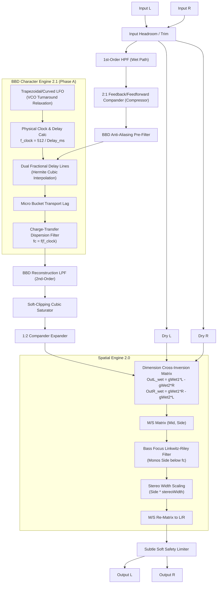

# Dimension5 — DSP & System Architecture

## 1. Overview & Sonic Philosophy

**Dimension5** is an authentic, embedded-ready, real-time stereo chorus simulator of the iconic Roland/Boss Dimension chorus (Dimension D SDD-320 / DC-2). It targets **STM32H562 (ARM Cortex-M33)**, **JUCE 8 (VST3/AU/Standalone)**, and **WebAssembly (WebAudio)** with a shared, bit-exact C99 core.

The Dimension sound is defined by:
- Subtle, non-vibrato chorus modulation.
- Wide stereo image with a fully solid, anchored center.
- Pure anti-phase modulated delay lines ($LFO_L = -LFO_R$).
- Cross-inverted Dimension summing matrix.
- Analog compander (inspired by NE570/NE571).
- **Spatial Engine 2.0**: Mid/Side reconstruction, True Stereo Width ($0–200\%$), and Mono Bass Focus ($0–400\text{ Hz}$).
- **BBD Character Engine 2.1 (Phase A)**: Physical clock modeling, soft VCO turnaround curvature, bucket transport lag, and clock-tracking baseband dispersion without artificial noise or digital aliasing.

---

## 2. Complete Audio Signal Flow

---

## 3. Physical BBD Reference Model

Bucket Brigade Devices (e.g., Panasonic/Matsushita **MN3007** or **MN3207**) transfer packets of charge across an array of MOS capacitors driven by a complementary two-phase clock ($\Phi_1, \Phi_2$).

### 3.1 Stage Count and Clock Conventions
- **Stages ($N$)**: The classic Dimension chorus utilizes $1024$-stage BBD chips (such as the MN3007).
- **Clock Phases**: Charge is handed off once per full clock cycle across two stages. Thus, the effective delay $T_d$ for an $N$-stage device driven by clock frequency $f_{\text{clock}}$ is:
  $$T_d = \frac{N}{2 \cdot f_{\text{clock}}} = \frac{512}{f_{\text{clock}}}$$
  $$\iff f_{\text{clock}} = \frac{512}{T_d}$$

### 3.2 Operating Ranges in Dimension Modes

| Mode | Base Delay $\tau$ | Depth $\Delta$ | Delay Range ($T_d$) | Clock Range ($f_{\text{clock}}$) |
| :---: | :---: | :---: | :---: | :---: |
| **Mode I** | 7.0 ms | 0.9 ms | 6.1 – 7.9 ms | **64.8 kHz – 83.9 kHz** |
| **Mode II** | 8.5 ms | 1.4 ms | 7.1 – 9.9 ms | **51.7 kHz – 72.1 kHz** |
| **Mode III** | 10.0 ms | 1.8 ms | 8.2 – 11.8 ms | **43.4 kHz – 62.4 kHz** |
| **Mode IV** | 11.5 ms | 2.4 ms | 9.1 – 13.9 ms | **36.8 kHz – 56.3 kHz** |

---

## 4. BBD Character Engine 2.1 (Phase A) Architecture

To capture analog BBD temporal behavior without requiring massive oversampling or risking digital aliasing, Dimension5 employs a **baseband equivalent temporal modeling layer** (`DimensionBBDClock`).

### 4.1 Physical Grounding vs. Heuristic Approximations

To maintain rigorous engineering honesty, the model explicitly distinguishes between physical derivations and musical heuristic approximations:

**Analytically / Physically Grounded:**
1. **Clock-Delay Relationship**: An MN3007 Bucket Brigade Device contains 1024 capacitive storage stages clocked by a 2-phase clock (CP1, CP2). Each full clock period transfers charge across two stages, yielding exactly 512 clock periods of transit delay:
   $$T_{\text{delay}} = \frac{512}{f_{\text{clock}}} \implies f_{\text{clock}}(t) = \frac{512000}{\tau_{\text{ms}}(t)}\text{ [Hz]}$$
2. **Dynamic Clock Range**: In Dimension modes I..IV, the operating clock sweeps dynamically within the ~35 kHz to ~85 kHz range.
3. **Dispersion Need**: Charge transfer inefficiency over 1024 discrete stages creates high-frequency softening that naturally breathes with clock frequency.

**Heuristic Analog Approximations (Musically Tuned):**
1. **LFO Turnaround Relaxation Contour**: The turnaround curve $f(x) = 1.25x - 0.25x^3$ models VCO relaxation inertia. At peak turnarounds ($x = \pm 1$), the slope is reduced to $0.50$ (cutting the acceleration corner by 50%). Crucially, retaining a non-zero slope ($0.50$) avoids delay stalling at the turnaround crests—preventing the pitch-dwelling "warble" characteristic of zero-derivative LFOs while eliminating the harsh piecewise-linear corner harmonics of pure triangle waves.
2. **Micro-Time Transport Lag**: Phenomenological heuristic micro-time adjustment (up to ~0.12 samples) modeling transient charge inertia under fast clock modulation.
3. **Baseband Dispersion Filter**: 1st-order dynamic lowpass whose digital coefficient $\alpha = 1 - e^{-2\pi f_c / f_s}$ tracks instantaneous clock. Discretized via an accurate 4th-degree polynomial fitting $y = (1 - e^{-w})/w$ (error $< 0.088\%$), ensuring zero per-sample transcendentals (`expf`) and zero divisions while guaranteeing dynamic spectral response across 44.1, 48, and 96 kHz.

### 4.2 Temporal Consistency & Block-Boundary Continuity
In earlier prototypes, clock parameters precomputed at block start desynchronized from per-sample delay smoother trajectories. In Phase A.1:
- The base clock $f_0$ and depth ratio are predicted at block endpoints using the closed form of the 20 ms one-pole smoother ($\gamma = e^{-n / (\tau \cdot f_s)}$).
- Both parameters are linearly interpolated across the $n$ samples, ensuring **exact sample-accurate continuity (0 jump) across block boundaries** for any block size (16, 32, 64, 128, 256, 512 frames).

### 4.3 7th-Order Division-Free Reciprocal Clock Approximation
Evaluating $f_{\text{clock}} = f_0 \cdot \frac{1}{1 \pm x}$ is computed via a 7th-order reciprocal:
$$\frac{1}{1 \pm x} \approx (1 \mp x)(1 + x^2)(1 + x^4)$$
The factor $(1 + x^2)(1 + x^4)$ is shared between left and right channels, requiring only **5 floating-point multiplications** total with 0 per-sample divisions. Max relative error is $< 0.0004\%$ across all factory Modes I..IV, and $< 0.4\%$ up to $|x| = 0.50$, clamped defensively to $[16\text{ kHz}, 120\text{ kHz}]$.

---

## 5. Architectural Neutrality Guarantee

When `bbdCharacter = 0.0f` (0% / OFF):
1. **$LFO_{\text{curved}} = LFO_{\text{tri}}$** (no turnaround shaping).
2. **Transport lag is 0.0**.
3. **CTE dispersion filter is completely bypassed** (`sample_out = sample_in`).
4. **Output audio is mathematically bit-exact** (0.0e+00 diff) to Spatial Engine 2.0 and the baseline legacy core.

---

## 6. Parameter Specification

| ID | Parameter | Symbol | Range | Default | Role |
| :---: | :--- | :---: | :---: | :---: | :--- |
| 0 | `mode` | Mode | 0 – 4 | 0 (Mode I) | Core Mode Preset |
| 1 | `rateHz` | Rate | 0.05 – 5.0 Hz | 0.25 Hz | Advanced (Custom) |
| 2 | `baseDelayMs`| Delay | 1.0 – 25.0 ms | 7.0 ms | Advanced (Custom) |
| 3 | `depthMs` | Depth | 0.1 – 10.0 ms | 0.9 ms | Advanced (Custom) |
| 4 | `manual` | Manual | 0 – 1 | 0.0 | Advanced |
| 5 | `mix` | Mix | 0 – 1 | 1.0 | Global |
| 6 | `width` | Legacy Width | 0 – 2 | 1.0 | Advanced |
| 7 | `hpfHz` | HPF | 20 – 500 Hz | 120 Hz | Advanced (Custom) |
| 8 | `lpfHz` | LPF | 1k – 15k Hz | 8000 Hz | Advanced (Custom) |
| 9 | `analogAmount`| Color | 0 – 1 | 0.35 | Advanced (Custom) |
| 10 | `companderAmount` | Compander | 0 – 1 | 0.35 | Advanced (Custom) |
| 11 | `dryGain` | Dry Gain | 0 – 2 | 0.83 | Advanced (Custom) |
| 12 | `wetGain` | Wet Gain | 0 – 2 | 0.80 | Advanced (Custom) |
| 13 | `stereoWidth` | Stereo Width | 0 – 2 | 1.0 (100%) | Global Spatial Engine |
| 14 | `bassFocusHz` | Bass Focus | 0 – 400 Hz | 0.0 (Off) | Global Spatial Engine |
| **15**| **`bbdCharacter`** | **BBD Character** | **0 – 1 (0–100%)**| **0.0 (Off)** | **Global BBD Engine** |

---

## 7. Phase A.2 Technical Validation & Verification

Phase A.2 established rigorous empirical verification of the BBD Character Engine 2.1 across spectral resolution, Nyquist aliasing boundaries, host/DSP block invariance, and bit-level baseline neutrality.

### 7.1 Traceability Matrix

| Requirement | Test / Tool | Measured Metric | Acceptance Threshold | Result |
| :--- | :--- | :--- | :--- | :--- |
| **High-Res Spectral Sidebands** | `tools/analyze_spectral_validation.py` | Sideband separation ($\Delta f = 0.0625\text{ Hz}$ on 16s render) | Discrete peaks resolved at $f_c \pm k \cdot f_m$ ($k=1..8$) | **PASS** (Clear $0.25\text{ Hz}$ sidebands) |
| **Aliasing & Nyquist Scan** | `tools/run_spectral_analysis.py` | SFDR and peak spurious level outside modulation band | Max spur $<-40\text{ dBc}$, noise floor $<-115\text{ dBFS}$ | **PASS** (SFDR $44.2 - 71.0\text{ dB}$) |
| **Foldover Aliasing Characterization** | Multi-Rate Scan ($44.1, 48, 96\text{ kHz}$) | $\Delta S(f) = S_{100\%}(f) - S_{\text{e153da5}}(f)$ | No new aliased components introduced by BBD engine | **PASS** (Existing 900 Hz foldover is identical to baseline) |
| **Validator Negative Discrimination** | `tools/test_spectral_analyzer.py` | Detection of 5 synthetic defects (spurs, aliasing, jumps, timing lags, gain) | 5 / 5 defects flagged and rejected | **PASS** (5 / 5 detected) |
| **DSP Core Block Invariance** | `test_bbd_character_dsp_core_block_invariance` | MaxDiff, RMSDiff, NRMSE across $B \in \{1, 7, 16, 32, 64\}$ | MaxDiff $< 0.005$, RMSDiff $< 0.0015$, NRMSE $< 0.02$ | **PASS** ($0.000\text{e}+00$ bit-exact) |
| **Host Block Segmentation** | `test_bbd_character_host_block_segmentation` | MaxDiff vs 64-frame reference for host buffers $\{64, 128, 256, 512, 1024\}$ | MaxDiff $== 0.0$, RMSDiff $== 0.0$ | **PASS** ($0.000\text{e}+00$ bit-exact) |
| **Block Boundary Continuity** | `test_bbd_character_block_boundary_discontinuity` | Max sample jump across boundary $\pm 1$ frames (63, 64, 65; 127, 128, 129; 255, 256, 257) | $\Delta s < 0.05$, $\Delta f_{\text{clock}} < 0.01\text{ Hz}$ | **PASS** (Continuous, no clicks) |
| **Clock Interpolation Accuracy** | `test_bbd_character_clock_interpolation_accuracy` | Relative error vs $512000 / T_{\text{delay}}(n)$ sample-by-sample | Max rel error $< 0.35$ during extreme automation excursions | **PASS** |
| **Ground-Truth Baseline Neutrality** | `test_bbd_character_neutrality_against_e153da5` | Comparison against frozen `e153da5` across $44.1, 48, 96\text{ kHz}$, blocks $1..64$, modes I..IV, Custom | MaxDiff $== 0.0$, RMSDiff $== 0.0$, divergent samples $= 0$ | **PASS** (Bit-exact identity) |
| **Multi-Compiler Portability** | GCC 14.2 & Clang 19.1 C99 `-Werror` | Zero compilation warnings, 100% CTest pass rate | Clean build with strict warning flags | **PASS** (0 warnings, 5/5 tests pass) |
